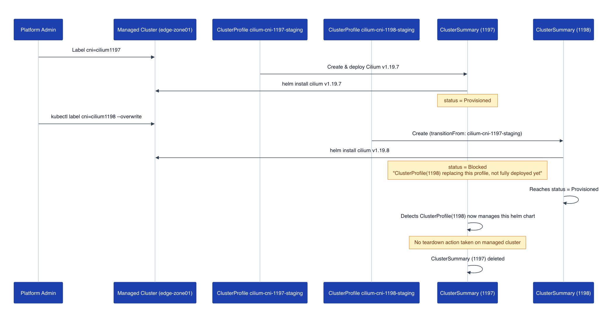

**Summary**:

Taking a look at the latest Sveltos releases, a lot has changed and, most importantly, improved around Day 2 operations and fleet management. This is all thanks to the valuable feedback coming from the community, bringing the experience and lessons learned from the field. In today's post, we take a look at how we can improve our Day 2 Operations using the Sveltos ClusterProfiles. We will work with Cilium and update our fleet from one version to the other with no downtime.

<!--truncate-->

## Introduction

For those new to [Sveltos](https://projectsveltos.io/main/addons/addons/), the two most commonly used Sveltos Custom Resource Definitions (CRDs) are the `ClusterProfile` and `Profile` resources. The first one applies to a cluster as a whole, and it is ideal for global-scoped deployments, while the second one is more suitable for namespace-scoped resources. For more details and information about the different resources, take a look at the [Overview and Architecture section](https://projectsveltos.io/main/overview/introdution/introduction_to_sveltos/).


Before **v1.15.0**, to update `ClusterProfile` resources from one application version to another, we simply set the right label on the target Kubernetes cluster. Using this approach, the resources defined in the `ClusterProfile` were **undeployed** since they were managed by the initial `ClusterProfile`, and then **deployed** from the second `ClusterProfile`, which contained the latest label attached to a Kubernetes-managed cluster. Note that a **plain label swap** always _undeploys-then-redeploys_, even when the two profiles are nearly identical.

While this approach might have been fine for specific applications or use cases, it is not suitable for the underlying network or global resources required by our clusters. Starting with **v1.15.0**, we can use the `transitionFrom` field within our `ClusterProfile`/`Profile` resources and declare which `ClusterProfile`/`Profile` instance we are replacing.

### How does transitionFrom work?

- The system defers the teardown of the named instance's resources on the targeted cluster. This happens until the new instance reaches the **Provisioned** state.
- The new instance may take over resources currently owned by the named instance, regardless of tier. Sveltos tiers provide a way of managing deployment priority when resources are targeted by **multiple configurations**.

Once the new instance reaches Provisioned, the old instance's next reconcile finds nothing left to wait on and cleanly undeploys whatever is left from the old instance.

## Scenario

Since we work a lot with provisioning and deployment of Kubernetes clusters, the scenario today covers the topic of updating the underlying Cilium CNI from **v1.19.7** to **v1.19.8.** Keep in mind, updates to the underlying network layer should be handled with care and treated as critical updates since they can lead to downtime. According to the Cilium official documentation, while performing an update, the datapath should be functional with [caveats](https://docs.cilium.io/en/stable/operations/upgrade/#version-specific-notes). In this post, we focus on Sveltos and how it treats Day 2 Operations with care using the `transitionFrom` field.

:::note
Initially, the RKE2 cluster does not have a default CNI defined. The deployment is covered by Sveltos upon cluster registration using a `ClusterProfile` resource. More details coming up next.
:::

## Lab Setup

```bash
+-------------------------+--------------+------------------+
|        Resources        |     Type     |     Version      |
+-------------------------+--------------+------------------+
|   Management Cluster    |     RKE2     |  v1.36.5+rke2r1  |
|         Cilium          |  Helm Chart  | v1.19.7, v1.19.8 |
|        Sveltos          |  Helm Chart  |     v1.16.0      |
+-------------------------+--------------+------------------+
```

## GitHub Resources

The YAML outputs are not complete. Have a look at the [GitHub repository](https://github.com/egrosdou01/blog-post-resources/tree/main/sveltos-transitionfrom/pt1).

## Diagram



The diagram outlines the stages a deployment goes through when the `transitionFrom` field is added.

## Prerequisites

1. A Kubernetes cluster
1. A recent Helm version installed
1. **kubectl** installed/available. Find the guide [here](https://kubernetes.io/docs/tasks/tools/install-kubectl-linux/).
1. **sveltosctl** (Optional). Find the installation details [here](https://projectsveltos.io/main/getting_started/sveltosctl/sveltosctl/).

## RKE2 Configuration

Since we want to allow Sveltos to deploy the CNI of our preference, we will create a new RKE2 cluster with no CNI defined. The configuration looks like the following and should be stored under the `/etc/rancher/rke2/` directory.

```yaml showLineNumbers
write-kubeconfig-mode: 0644
tls-san:
  - Your TLS SAN Definition
token: Your Token Value
cni: none
cluster-cidr: "10.42.0.0/16"
service-cidr: "10.43.0.0/16"
node-ip: "The Node IP Address"
disable-kube-proxy: true # We disable kube-proxy since we will use Cilium to handle the service traffic via eBPF
etcd-expose-metrics: false
```

### Validation

Once the Kubernetes cluster is up and running, the attached cluster nodes will be in a **NotReady** state since there is no CNI to support network functionality for that cluster.

```bash
$ kubectl get nodes
NAME                   STATUS     ROLES                AGE   VERSION
rke2-sveltos-master    NotReady   control-plane,etcd    65m   v1.36.5+rke2r1
rke2-sveltos-worker    NotReady   control-plane,etcd    65m   v1.36.5+rke2r1

$ kubectl get pods -n kube-system -l app.kubernetes.io/part-of=cilium -w
...
```

## Sveltos Installation

We already have Sveltos installed in a Kubernetes management cluster. The management cluster reflects the center of our operations when it comes to fleet management. As we follow a GitOps approach, any existing GitOps Controllers like ArgoCD and Flux work hand-in-hand with Sveltos to synchronise resources to the management cluster, and then Sveltos will take over to deploy the manifests to a fleet of clusters using a label-based approach.

### Helm Chart Installation

For this demo, I am using the [installation Mode 1](https://projectsveltos.io/main/getting_started/install/install/#mode-1-local-agent-mode-manifest) option where a Sveltos agent will be present on the managed clusters. To explore the different installation modes, take a look at the [Sveltos Installation section](https://projectsveltos.io/main/getting_started/install/install/).

```bash
$ helm repo add projectsveltos https://projectsveltos.github.io/helm-charts
$ helm repo update
$ helm install projectsveltos projectsveltos/projectsveltos -n projectsveltos --create-namespace
```

### Cluster Registration

Once the Sveltos deployment is complete, it is time to register the RKE2 cluster with Sveltos. Keep in mind a registration is not required when we work with Cluster API (CAPI) clusters since Sveltos detects those automatically.

```bash
$ sveltosctl register cluster --namespace=staging \
  --cluster=edge-zone01 \
  --kubeconfig=/path/to/kubeconfig/managed/cluster \
  --labels=env=staging,cni=cilium1197
```

For simplicity, we use the `sveltosctl` utility to perform the registration; however, this is not the only way of registering clusters. Feel free to use any of the available options listed [here](https://projectsveltos.io/main/register/register-cluster/).

Taking a look at the registration command, we already assigned the labels _env=staging_ and _cni=cilium1197_ to the cluster. Remember the labels defined here, as we will see them later on when we talk about the Sveltos `ClusterProfile` resources. 

### Validation

Let's ensure the cluster was successfully registered with Sveltos and the right set of labels are attached to it.

```bash
$ kubectl get sveltosclusters -A --show-labels
NAMESPACE   NAME            READY   VERSION          AGE   SHARD   LABELS
mgmt        mgmt            true    v1.36.5+rke2r1   22d           projectsveltos.io/k8s-version=v1.36.5,sveltos-agent=present
staging     edge-zone01     true    v1.36.5+rke2r1   94m           cni=cilium1197,env=staging,projectsveltos.io/k8s-version=v1.36.5,sveltos-agent=present
```

## Sveltos Resources

It is time to continue and explore the Sveltos `ClusterProfile` resources related to Cilium. In the first manifest, we match clusters with the labels _env=staging_ and _cni=cilium1197_ and then deploy Cilium **v1.19.7** as a Helm chart. The second manifest matches clusters with the labels set to _env=staging_ and _cni=cilium1198_ and deploys Cilium **v1.19.8** as a Helm chart. The only difference with the second manifest is the `transitionFrom` field pointing to the name of the first `ClusterProfile`.

### ClusterProfile - Cilium v1.19.7

```yaml showLineNumbers
apiVersion: config.projectsveltos.io/v1beta1
kind: ClusterProfile
metadata:
  name: cilium-cni-1197-staging
spec:
  clusterSelector:
    matchLabels:
      env: staging
      cni: cilium1197
  helmCharts:
  - chartName: cilium/cilium
    chartVersion: 1.19.7
    helmChartAction: Install
    releaseName: cilium
    releaseNamespace: kube-system
    repositoryName: cilium
    repositoryURL: https://helm.cilium.io/
    values: |
      k8sServiceHost: "Your API Server IP Address"
      k8sServicePort: 6443
      kubeProxyReplacement: true
```

### ClusterProfile - Cilium v1.19.8

```yaml showLineNumbers
apiVersion: config.projectsveltos.io/v1beta1
kind: ClusterProfile
metadata:
  name: cilium-cni-1198-staging
spec:
  clusterSelector:
    matchLabels:
      env: staging
      cni: cilium1198
  transitionFrom:
  - cilium-cni-1197-staging
  helmCharts:
  - chartName: cilium/cilium
    chartVersion: 1.19.8
    helmChartAction: Install
    releaseName: cilium
    releaseNamespace: kube-system
    repositoryName: cilium
    repositoryURL: https://helm.cilium.io/
    values: |
      k8sServiceHost: "Your API Server IP Address"
      k8sServicePort: 6443
      kubeProxyReplacement: true
```

```bash
$ export KUBECONFIG=/path/to/management/cluster/kubeconfig

$ kubectl apply -f sveltos_day2_resources/
```

### Validation

**Management Cluster**

```bash

$ kubectl get clusterprofile,clustersummary -A

NAMESPACE   NAME                                                              AGE
            clusterprofile.config.projectsveltos.io/cilium-cni-1197-staging   7m34s
            clusterprofile.config.projectsveltos.io/cilium-cni-1198-staging   2m13s

NAMESPACE   NAME                                                                                  AGE
staging     clustersummary.config.projectsveltos.io/cilium-cni-1197-staging-sveltos-edge-zone01   7m34s
```

```bash
$ kubectl get clustersummary cilium-cni-1197-staging-sveltos-edge-zone01 -n staging -o yaml
status:
  dependencies: no dependencies
  featureSummaries:
  - featureID: Helm
    hash: 9rJYpd+EnI454a7KI9pqLYB44X/xTUkTxlu6AHww5bI=
    lastAppliedTime: "2026-10-13T11:59:54Z"
    resourceSummaryDeployed: false
    status: Provisioned
  helmReleaseSummaries:
  - chartName: cilium/cilium
    chartVersion: 1.19.7
    releaseName: cilium
    releaseNamespace: kube-system
    repoURL: https://helm.cilium.io/
    repositoryName: cilium
    status: Managing
    valuesHash: wRgxTZp4IJS12t2h9AH9ODSw7XEsS9Dqyq0T/XmW1a4=
```

We have only one `ClusterSummary` resource available since we match on one cluster with the label set to `cni: cilium1197`. If more clusters had this label, more `ClusterSummary` instances were going to be displayed.

**Managed Cluster**

```bash
$ kubectl get pods -n kube-system -l app.kubernetes.io/part-of=cilium -w
NAME                               READY   STATUS    RESTARTS   AGE
cilium-envoy-j5n8s                 1/1     Running   0          36s
cilium-operator-7bbf976ddf-gw5tv   1/1     Running   0          36s
cilium-tx8h5                       1/1     Running   0          36s

$ kubectl describe pod cilium-tx8h5 -n kube-system | grep -i "image:" -m 1
    Image:         quay.io/cilium/cilium:v1.19.7@sha256:1b58bcb81c723cf130a0dd2fb2e1132c57f8fbc2ef7bdb85519cfcc36111c77e
```

As expected, the desired Cilium version **1.19.7** was deployed on the target cluster.

## Update Managed Cluster Label

Let's update Cilium from **v1.19.7** to **v.1.19.8**. Since we already have two `ClusterProfile` resources in the management cluster, we just need to update the label _cni=cilium1197_ from the managed cluster to _cni=cilium1198_. Once we do so, Sveltos will notice the `transitionFrom` value defined in the second `ClusterProfile` and perform a smooth update. During the update process, two `ClusterSummary` resources will be available, one for **v1.19.7** and another one for **v1.19.8**. Sveltos then will realise that another `ClusterProfile` manages the Cilium Helm chart and does nothing. It will delete the `ClusterSummary` pointing to **1.19.7** with no action taken on the **managed** cluster.

```bash
$ kubectl label sveltoscluster edge-zone01 -n staging cni=cilium1198 --overwrite

$ kubectl get sveltosclusters -A --show-labels
NAMESPACE   NAME            READY   VERSION          AGE   SHARD   LABELS
mgmt        mgmt            true    v1.36.5+rke2r1   22d           projectsveltos.io/k8s-version=v1.36.5,sveltos-agent=present
staging     edge-zone01     true    v1.36.5+rke2r1   94m           cni=cilium1198,env=staging,projectsveltos.io/k8s-version=v1.36.5,sveltos-agent=present
```

### Validation Management Cluster

```bash
$ kubectl get clusterprofile,clustersummary -A
NAMESPACE   NAME                                                              AGE
            clusterprofile.config.projectsveltos.io/cilium-cni-1197-staging   7m34s
            clusterprofile.config.projectsveltos.io/cilium-cni-1198-staging   2m13s

NAMESPACE   NAME                                                                                  AGE
staging     clustersummary.config.projectsveltos.io/cilium-cni-1197-staging-sveltos-edge-zone01   7m34s
staging     clustersummary.config.projectsveltos.io/cilium-cni-1198-staging-sveltos-edge-zone01   23s
```

```bash
$ kubectl get clustersummary cilium-cni-1197-staging-sveltos-edge-zone01 -n staging -o yaml
status:
  dependencies: ClusterProfile cilium-cni-1198-staging is replacing this profile on
    this cluster but is not fully deployed yet
  featureSummaries:
  - featureID: Helm
    lastAppliedTime: "2026-10-13T11:59:54Z"
    resourceSummaryDeployed: false
    status: Blocked
```

```bash
$ kubectl get clustersummary cilium-cni-1198-staging-sveltos-edge-zone01 -n staging -o yaml
status:
  dependencies: no dependencies
  featureSummaries:
  - featureID: Helm
    hash: jgCCGtcM2zbV4ki5qkHpXD3zmueXZ45bFoQf7kM/aK8=
    lastAppliedTime: "2026-10-13T12:02:46Z"
    resourceSummaryDeployed: false
    status: Provisioned
  helmReleaseSummaries:
  - chartName: cilium/cilium
    chartVersion: 1.19.8
    releaseName: cilium
    releaseNamespace: kube-system
    repoURL: https://helm.cilium.io/
    repositoryName: cilium
    status: Managing
    valuesHash: wRgxTZp4IJS12t2h9AH9ODSw7XEsS9Dqyq0T/XmW1a4=
```

The status description of the `ClusterSummary` _cilium-cni-1197-staging-sveltos-edge-zone01_ resource "ClusterProfile cilium-cni-1198-staging is replacing this profile on this cluster but is not fully deployed yet" is what we described at the beginning of the post. Sveltos performs a smooth transition instead of tearing down and redeploying resources.

### Validation Managed Cluster

```bash
$ export KUBECONFIG=/path/to/managed/kubeconfig

$ kubectl get pods -n kube-system -l app.kubernetes.io/part-of=cilium -w
NAME                               READY   STATUS    RESTARTS   AGE
cilium-envoy-j5n8s                 1/1     Running   0          50s
cilium-operator-7bbf976ddf-gw5tv   1/1     Running   0          50s
cilium-tx8h5                       1/1     Running   0          50s
cilium-tx8h5                       1/1     Terminating   0          59s
cilium-envoy-j5n8s                 1/1     Terminating   0          59s
cilium-tx8h5                       1/1     Terminating   0          59s
cilium-operator-55475586cd-h59z7   0/1     Pending       0          0s
cilium-envoy-j5n8s                 1/1     Terminating   0          59s
cilium-operator-55475586cd-h59z7   0/1     Pending       0          0s
cilium-operator-7bbf976ddf-gw5tv   1/1     Terminating   0          59s
cilium-operator-7bbf976ddf-gw5tv   1/1     Terminating   0          59s
cilium-tx8h5                       0/1     Completed     0          59s
cilium-785fh                       0/1     Pending       0          0s
cilium-785fh                       0/1     Pending       0          0s
cilium-operator-7bbf976ddf-gw5tv   0/1     Error         0          59s
cilium-operator-55475586cd-h59z7   0/1     Pending       0          0s
cilium-785fh                       0/1     Init:0/6      0          0s
cilium-operator-55475586cd-h59z7   0/1     ContainerCreating   0          0s
cilium-operator-55475586cd-h59z7   0/1     ContainerCreating   0          1s
cilium-785fh                       0/1     Init:0/6            0          1s
cilium-785fh                       0/1     Init:0/6            0          1s
cilium-operator-7bbf976ddf-gw5tv   0/1     Error               0          60s
cilium-operator-7bbf976ddf-gw5tv   0/1     Error               0          60s
cilium-operator-55475586cd-h59z7   0/1     Running             0          1s
cilium-tx8h5                       0/1     Completed           0          60s
cilium-tx8h5                       0/1     Completed           0          60s
cilium-tx8h5                       0/1     Completed           0          60s
cilium-envoy-j5n8s                 0/1     Error               0          61s
cilium-envoy-49cb2                 0/1     Pending             0          0s
cilium-envoy-49cb2                 0/1     Pending             0          0s
cilium-envoy-49cb2                 0/1     ContainerCreating   0          0s
cilium-envoy-j5n8s                 0/1     Error               0          61s
cilium-envoy-j5n8s                 0/1     Error               0          61s
cilium-operator-55475586cd-h59z7   1/1     Running             0          2s
cilium-785fh                       0/1     Init:1/6            0          2s
cilium-785fh                       0/1     Init:1/6            0          2s
cilium-envoy-49cb2                 0/1     ContainerCreating   0          0s
cilium-envoy-49cb2                 0/1     Running             0          1s
cilium-785fh                       0/1     Init:2/6            0          3s
cilium-785fh                       0/1     Init:2/6            0          3s
cilium-785fh                       0/1     Init:3/6            0          4s
cilium-785fh                       0/1     Init:3/6            0          4s
cilium-785fh                       0/1     Init:4/6            0          5s
cilium-785fh                       0/1     Init:4/6            0          5s
cilium-785fh                       0/1     Init:5/6            0          6s
cilium-785fh                       0/1     Init:5/6            0          6s
cilium-785fh                       0/1     PodInitializing     0          7s
cilium-785fh                       0/1     Running             0          7s
cilium-785fh                       0/1     Running             0          9s
cilium-envoy-49cb2                 0/1     Running             0          8s
cilium-envoy-49cb2                 1/1     Running             0          8s
cilium-785fh                       0/1     Running             0          13s
cilium-785fh                       1/1     Running             0          13s
```

```bash
$ kubectl describe pod cilium-785fh -n kube-system | grep -i image -m 1
    Image:         quay.io/cilium/cilium:v1.19.8@sha256:e9f7ee1f2f3a41e44339612e3b6b88170bdde7679c9c9461f287bb27702a8ecf
```

### Connectivity Test (Optional)

We can optionally perform a simple network test during the CNI update using `nc` (netstat). Once again, we expect the datapath to work during the update with caveats. For more information about Cilium and how to update between minor versions, take a look at the Cilium official documentation.

The pod manifests are available [here](https://github.com/egrosdou01/blog-post-resources/tree/main/sveltos-transitionfrom/pt1).

## Conclusion

Sveltos is becoming the tool it is today thanks to the community support and the feedback provided! The way we handle Day 2 operations is equally important as Day 0 and Day 1 operations. We always strive to keep our application running and achieve a high level of availability while reducing errors and disruptions to a small percentage. In this post, we explored how to supercharge Day 2 operations by performing a smooth transition from one version to another! Stay tuned for future posts on Day 2 Operations.

## Resources

- [Sveltos Quick Start](https://projectsveltos.io/main/getting_started/install/quick_start/)
- [Sveltos Smooth Transition](https://projectsveltos.io/main/deployment_order/transition_from/)

## ✉️ Contact

If you have any questions, feel free to get in touch! You can use the `Discussions` option found [here](https://github.com/egrosdou01/blog.grosdouli.dev/discussions) or reach out to me on any of the social media platforms provided. 😊 We look forward to hearing from you!

## Series Navigation

| Part | Title |
| :--- | :---- |
| [Part 1](./sveltos-smooth-clusterprofile-transition-cilium-cni.md) | Introduction to Sveltos ClusterProfile and transitionFrom |
| Part 2 | Introduction to Sveltos ValidateHealths |
