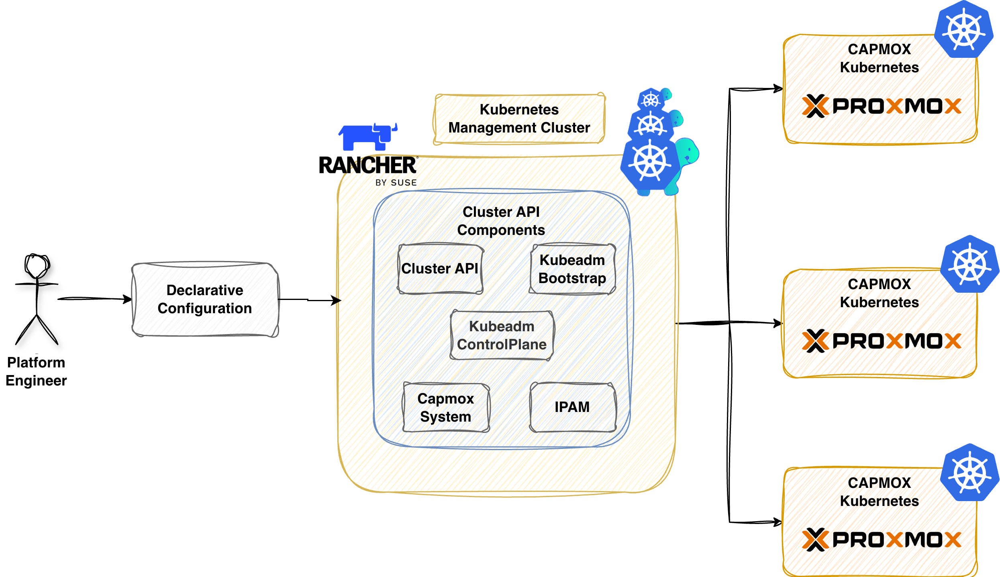

**Summary**:

In the past, we talked about [CAPMOX deployments](https://github.com/ionos-cloud/cluster-api-provider-proxmox) and how they work on a Proxmox server running  version **8.4.x**. Today's post is an update on what changed with the [image-builder](https://github.com/kubernetes-sigs/image-builder) and what the required changes are to create [Cluster API (CAPI)](https://cluster-api.sigs.k8s.io/introduction) clusters on a Proxmox server running version **9.2.x**.

<!--truncate-->


## Introduction

If you are not familiar with CAPMOX deployments and how to create Kubernetes managed clusters on Proxmox, take a look at the [previous post](../2026-01-22-capi-proxmox-cilium-sveltos/k8s-managed-clusters-capmox.md). While the blog post is detailed and provides the required information and resources to create Kubernetes clusters, recent changes to the image-builder and the Proxmox server version demanded an update of the post.

In this demonstration, we will go through the gotchas following the steps outlined in the initial post and how to tackle them to get a working deployment. Let's dive into the details.

## Prerequisites

1. Sufficient permissions to create a dedicated Proxmox PVE user and a Token
1. A Kubernetes cluster
1. Familiarity with Kubernetes manifest files
1. [Helm](https://helm.sh/docs/intro/install/) version > v3.17.x installed
1. [kubectl](https://kubernetes.io/docs/tasks/tools/#kubectl) and [clusterctl](https://cluster-api.sigs.k8s.io/user/quick-start#install-clusterctl) are installed

## Lab Setup

```bash
+-----------------------------+------------------+----------------------+
|          Resources          |      Type        |       Version        |
+-----------------------------+------------------+----------------------+
|        Proxmox Server       |                  |        9.2.21        |
|        Ubuntu Server        |       VM         |     24.04.4 LTS      |
|     Management Cluster      |      RKE2        |     v1.36.5+rke2r1   |
+-----------------------------+------------------+----------------------+

+-------------------+----------+
|      Tools        | Version  |
+-------------------+----------+
|   clusterctl      | v1.14.3  |
+-------------------+----------+

+-------------------------------+----------+
|         Deployment            | Version  |
+-------------------------------+----------+
|           CAPMOX              | v0.9.2   |
|           Cilium              | v1.19.8  |
+-------------------------------+----------+
```

## Definitions

- **Image Builder**: It is a tool for building Kubernetes virtual machines across different infrastructure providers. Check out the [official GitHub repository](https://github.com/kubernetes-sigs/image-builder) for more details about the available options
- **CAPI**: Bring a declarative, Kubernetes-style API to cluster creation, configuration, and management
- **CAPMOX**: Enables efficient management of self-managed Kubernetes clusters on Proxmox

## Image Builder

The `image-builder` project relies on [HashiCorp Packer](https://www.packer.io/) and [Ansible](https://docs.ansible.com/?extIdCarryOver=true&intcmp=7015Y000003t7aWQAQ&sc_cid=RHCTG0180000382526) to build an image based on our preferences. Follow the sub-sections below to create a new base image for our Kubernetes clusters.

### Update Ansible

Before we install the image-builder required Proxmox dependencies, we need to ensure **Ansible >= v2.18.18** is available on our local machine. If not, the error below will pop up.

```bash
Detected ansible version: ansible [core 2.15.13].
Image builder requires 2.18.18 or greater.
Please install 2.18.18 or later.
```

There are two ways to work with this issue. Either install [pipx](https://packages.ubuntu.com/noble/pipx), which installs Ansible in an isolated virtual environment and exposes its commands globally through **PATH**, or create a new [Python virtual environment](https://docs.python.org/3.13/library/venv.html) with the required dependencies. Since I like working in a dedicated isolated spaces, I created the Python virtual environment.

#### Pipx

To follow along, ensure `sudo` commands can be executed from the logged-in user.

```bash
$ sudo apt update && sudo apt install -y pipx # Update packages and install pipx
$ pipx install --force 'ansible-core==2.18.18'
$ pipx upgrade ansible-core
```

```bash
$ ansible --version
ansible [core 2.21.6]
```

#### Python venv

```bash
$ python3 -m venv ./venv
$ source ~/.venv/bin/activate
$ pip install --upgrade pip
$ pip install ansible=2.18.18 # Install the full Ansible package
OR
$ pip install ansible-core=2.18.18 # Minimal Ansible Core package
```

```bash
$ pip list
Package      Version
------------ -------
ansible-core 2.18.18
cffi         2.1.1
cryptography 50.0.2
Jinja2       3.1.6
MarkupSafe   3.0.4
packaging    26.3
pip          26.3
pycparser    3.12
PyYAML       6.0.3
resolvelib   1.0.1
```

### Proxmox - image-builder User

An image-builder user is required to push the downloaded `.iso` to the Proxmox server, generate a virtual machine, apply configuration changes, and finally, convert it into a template. Based on the official documentation, we can either work with the `PVEAdmin` user or create a dedicated user following the [least-privileges approach](https://github.com/ionos-cloud/cluster-api-provider-proxmox/blob/main/docs/advanced-setups).

```bash
$ ssh username@IP Address Proxmox Server

$ pveum user add image-builder@pve --expire 1794219000 # Create a new user named image-builder@pve. Set the epoch timestamp based on your needs.
$ pveum aclmod / -user image-builder@pve -role PVEVMAdmin # Assign the PVEAdmin role to the created user
$ pveum user token add image-builder@pve image-builder --expire 1794219000 -privsep 0 # Create a token with name image-builder associated with the image-builder user, disable privileged separation
```

### image-builder - Clone Repository

Clone the `image-builder` public repository.

```bash
$ git clone https://github.com/kubernetes-sigs/image-builder.git && cd image-builder/images/capi
```

### Install Proxmox Dependencies

```bash
$ make deps-proxmox
```

### Export Required Variables

We can either use our favourite secret management solution or, for non-production deployments, store them in a `setenv` file and exclude it using `.gitignore`.

**Proxmox Details**

```bash
$ export PROXMOX_URL="https://PROXMOX_IP|HOSTNAME:PORT/api2/json"
$ export PROXMOX_USERNAME='image-builder@pve!image-builder'
$ export PROXMOX_TOKEN='5d44bf10-1234-5678-9101-ff7bdd8963fa'
$ export PROXMOX_NODE="pve"
$ export PROXMOX_ISO_POOL="local"
$ export PROXMOX_STORAGE_POOL="local-lvm"
$ export PROXMOX_BRIDGE="vmbr0"
$ export PROXMOX_NIC_MODEL="virtio"
```

The `PROXMOX_STORAGE_POOL` is set to `local-lvm`, and the `DISK_FORMAT` should be set to `raw`. The second variable can be defined directly as a `PACKER_FLAGS` argument. See below.

**Packer Details**

```bash
$ export PACKER_LOG=1
$ export PACKER_FLAGS="--var 'kubernetes_rpm_version=1.36.5' --var 'kubernetes_semver=v1.36.5' --var 'kubernetes_series=v1.36' --var 'kubernetes_deb_version=1.36.5-1.1' --var 'disk_format=raw'"
```

:::warning
Ensure the `PROXMOX_URL` contains the API endpoint. If you provide only the `PROXMOX_IP/HOSTNAME:PORT`, the image-builder will fail as it cannot talk via API calls with the Proxmox server.
:::

:::tip
The machine where the image is built should be in the **same subnet or reachable via the network to reach the Proxmox server**. If not, the process will fail. Ensure the `PROXMOX_BRIDGE` variable is the one that the underlying machine and the Proxmox server are located on.
:::

### Build Base Image

The image build process can take up to 20 minutes. Do not stop the execution. If an error occurs, the execution will stop automatically with an indication of the error.

```bash
$ make build-proxmox-ubuntu-2404
```

:::warning
Even if the right set of permissions assigned to the `image-builder@pve` user and the token, the build process kept stopping with the error below.

```bash
--> proxmox-iso.ubuntu-2404: Post "https://PROXMOX_IP|HOSTNAME:PORT//api2/json/nodes/pve/storage/local/upload": dial tcp PROXMOX_IP|HOSTNAME:PORT: connect: connection refused
```

A quick check is to CURL the Proxmox API server and see if the authenticated user/token is valid.

```bash
$ curl -k -H "Authorization: PVEAPIToken=<user>@pve!<token>=<token-secret>" https://<PROXMOX_IP>:8006/api2/json/version
```

Once the right permissions are assigned to the user/token, continue with the [workaround section](./k8s-managed-clusters-capmox-tshoot-insights.md#build-base-image---workaround). We will skip the `.iso` upload to Proxmox (do it manually) and start building the image based on an already uploaded base image.
:::

#### Build Base Image - Workaround

With image-builder, we can define the location of the `.iso` on our Proxmox server by setting the `ISO_FILE` variable. For example, if a base Ubuntu 24.04 image is available under `local:iso`, the command will be ```export ISO_FILE="local:iso/ubuntu-24.04.4-live-server-amd64.iso"```.

Since we use the latest image-builder release, the `packer-plugin-proxmox` `>= 1.2.0` breaks the build when we expose the `ISO_FILE` variable. This happens because the `iso_file`, `iso_url`, and `unmount_iso` settings are moved into the `boot_iso` block. Since we do not want to make changes to the Packer configuration, we will downgrade the Packer plugin. Follow the commands listed below.

```hcl
$ vi images/capi/packer/proxmox/config.pkr.hcl
packer {
  required_plugins {
    proxmox = {
      version = "= 1.1.8" # v1.1.8 should be defined as a workaround
      source  = "github.com/hashicorp/proxmox"
    }
  }
}
```

Remove any cached Packer plugin versions (v1.2.x) before re-running the Proxmox dependencies command.

```bash
$ rm ~/.packer.d/plugins/github.com/hashicorp/proxmox/packer-plugin-proxmox_v1.2.*
$ cd ~/Git cloned directory/image-builder/images/capi && make deps-proxmox
```

The command above will reinstall the Proxmox dependencies based on the new information located in the `images/capi/packer/proxmox/config.pkr.hcl` file.

Since we are working with an older plugin, we should be able to export and use the `ISO_FILE` variable. Ensure the variables below are exported alongside the [previously defined ones](./k8s-managed-clusters-capmox-tshoot-insights.md#export-required-variables).

```bash
$ export ISO_FILE="local:iso/ubuntu-24.04.4-live-server-amd64.iso"
$ export PACKER_LOG=1
$ export PACKER_FLAGS="--var 'kubernetes_rpm_version=1.36.5' --var 'kubernetes_semver=v1.36.5' --var 'kubernetes_series=v1.36' --var 'kubernetes_deb_version=1.36.5-1.1' --var 'disk_format=raw'"
```

We can now re-run the command ```make build-proxmox-ubuntu-2404```.

:::warning
The ```make build-proxmox-ubuntu-2404``` command will get interrupted a number of times. This is because the provided user does not have the right set of permissions when it comes to disk allocation, ISO access, network configuration, and general virtual machine operations.

**Common Errors:**

```bash
==> proxmox-iso.ubuntu-2404: Error creating VM: error creating VM: 403 Permission check failed (/storage/local-lvm, Datastore.AllocateSpace), error status: {"data":null,"message":"Permission check failed (/storage/local-lvm, Datastore.AllocateSpace)\n"}
```

```bash
==> proxmox-iso.ubuntu-2404: Error creating VM: error creating VM: 403 Permission check failed (/sdn/zones/localnetwork/vmbr0, SDN.Use), error status: {"message":"Permission check failed (/sdn/zones/localnetwork/vmbr0, SDN.Use)\n","data":null}
```

Update the `image-builder@pve` user and assign the permissions listed below.

```bash
$ pveum aclmod /storage/local-lvm -user image-builder@pve -role PVEDatastoreAdmin
$ pveum aclmod /storage/local -user image-builder@pve -role PVEDatastoreAdmin
$ pveum aclmod /sdn/zones/localnetwork/vmbr0 -user image-builder@pve -role PVESDNUser
```
:::

Re-run the command ```make build-proxmox-ubuntu-2404``` and wait until the process is successfully completed.

**Expected output**

```bash
==> proxmox-iso.ubuntu-2604: Creating VM
==> proxmox-iso.ubuntu-2604: No VM ID given, getting next free from Proxmox
==> proxmox-iso.ubuntu-2604: Starting VM
==> proxmox-iso.ubuntu-2604: Waiting 10s for boot
==> proxmox-iso.ubuntu-2604: Typing the boot command
2026/11/09 12:11:43 packer-plugin-proxmox_v1.1.8_x5.0_linux_amd64 plugin: 2026/11/09 12:11:43 [INFO] Waiting for SSH, up to timeout: 2h0m0s
==> proxmox-iso.ubuntu-2604: Waiting for SSH to become available...
2026/11/09 12:11:46 packer-plugin-proxmox_v1.1.8_x5.0_linux_amd64 plugin: 2026/11/09 12:11:46 [DEBUG] Error getting SSH address: 500 QEMU guest agent is not running
...
```

## Kubernetes Management Cluster

An [RKE2](https://search.brave.com/go/v1#AcUjbinK2rQaawAD3AGwBkLvFPFfiZUqqEZiS0VZgMPYc6YukPDTdijYt6WcFttFoR9CfQHDPCkGt5te-m0GqwFLbw-QPb411MNTwj1_5pth_gj9Hpm_1XF_oys8sBf8Vvt0fNqDtxy-S5lTuCF32pRY_GgHQXxMPu3RJNUeF0Ff7gtK-jXsCQ) cluster will act as the management cluster.

## clusterctl

To use the `clusterctl` utility, we must export the variables related to our Proxmox environment. The required variables are documented [here](https://image-builder.sigs.k8s.io/capi/providers/proxmox#example).

### Initialise Management Cluster

The section remains the same as the [original post](../2026-01-22-capi-proxmox-cilium-sveltos/k8s-managed-clusters-capmox.md). Follow the details outlined [here](../2026-01-22-capi-proxmox-cilium-sveltos/k8s-managed-clusters-capmox.md#initialise-management-cluster).

### Proxmox Cluster Details

To create a managed Kubernetes cluster, first we need to create a new user who will handle the creation and configuration of the virtual machines on Proxmox. In this demonstration, we will create and use the `capi-user` user with the permissions listed below.

```bash
$ ssh username@IP Address Proxmox Server

$ pveum user add capi-user@pve --expire 1794219000
$ pveum aclmod / -user capi-user@pve -role PVEAdmin
$ pveum user token add capi-user@pve capi -privsep 0 --expire 1794219000
```

```bash
# Proxmox Details
$ export PROXMOX_URL="https://<PROXMOX_IP/HOSTNAME>:<LISTENING PORT>"
$ export PROXMOX_TOKEN='capi-user@pve!capi-user'
$ export PROXMOX_SECRET="5d44bf10-1234-5678-9101-ff7bdd8963fb"
$ export PROXMOX_SOURCENODE="pve"
$ export TEMPLATE_VMID="The VM ID from the Ubuntu 24.04 template"

# Node Network Details
$ export VM_SSH_KEYS="ssh-ed25519" # Provide a valid SSH public key. To create a new SSH key, follow the instructions https://git-scm.com/book/en/v2/Git-on-the-Server-Generating-Your-SSH-Public-Key
$ export CONTROL_PLANE_ENDPOINT_IP=10.10.10.10
$ export NODE_IP_RANGES="[10.10.10.11-10.10.10.15]"
$ export BOOT_VOLUME_DEVICE="scsi0"
$ export GATEWAY="10.10.10.1"
$ export DNS_SERVERS="[10.10.10.1]"
$ export IP_PREFIX=24
$ export BRIDGE="vmbr2"
$ export NETWORK_MODEL="virtio" 
$ export ALLOWED_NODES="[pve]"

# Node Resource Details
$ export BOOT_VOLUME_SIZE="20"
$ export NUM_SOCKETS="1"
$ export NUM_CORE="1"
$ export MEMORY_MIB="4096"
$ export EXP_CLUSTER_RESOURCE_SET="true"
$ export CLOUD_INIT_CONFIG="#cloud-config package_update=true packages=- net-tools"
$ export CLUSTER_TOPOLOGY="true"
```

:::warning
Ensure the `PROXMOX_URL` follows the pattern `https://PROXMOX_IP/HOSTNAME:8006`. The `CONTROL_PLANE_ENDPOINT_IP` will be used to reach the `kubeapi-server` and needs to be a non-conflicting IP address within your network. It should be excluded from the `NODE_IP_RANGES` variable and the DHCP server (if used).
:::

```bash
clusterctl generate cluster proxmox01 \
  --kubernetes-version v1.36.5 \
  --control-plane-machine-count=1 \
  --worker-machine-count=2 \
  > proxmox01.yaml
```

**Enable memory over-commit**

We will simply patch the `proxmox01.yaml` file and add the details under the `ProxmoxCluster.spec` section.

```yaml showLineNumbers
apiVersion: infrastructure.cluster.x-k8s.io/v1alpha1
kind: ProxmoxCluster
metadata:
  name: proxmox01
  namespace: default
spec:
  ...
// highlight-start
  schedulerHints:
    memoryAdjustment: 0
// highlight-end
```

## Create Cluster

Apply the updated manifest file to the Kubernetes **management cluster** and let Proxmox create a cluster with one controller and two worker nodes.

```bash
$ export KUBECONFIG=/path/to/management/cluster
$ kubectl apply -f proxmox01.yaml
```

### Validation

```bash
$ kubectl get clusters,machines,proxmoxmachines
NAME                                 CLUSTERCLASS   AVAILABLE   CP DESIRED   CP AVAILABLE   CP UP-TO-DATE   W DESIRED   W AVAILABLE   W UP-TO-DATE   PHASE         AGE   VERSION
cluster.cluster.x-k8s.io/proxmox01                  True        1            1              1               2           2             2              Provisioned   11m   

NAME                                                     CLUSTER     NODE NAME                       FAILURE DOMAIN   READY   AVAILABLE   UP-TO-DATE   PHASE     AGE   VERSION
machine.cluster.x-k8s.io/proxmox01-control-plane-n6knt   proxmox01   proxmox01-control-plane-n6knt                    True    True        True         Running   11m   v1.36.5
machine.cluster.x-k8s.io/proxmox01-workers-qcc4t-xr29m   proxmox01   proxmox01-workers-qcc4t-xr29m                    True    True        True         Running   11m   v1.36.5
machine.cluster.x-k8s.io/proxmox01-workers-qcc4t-z949m   proxmox01   proxmox01-workers-qcc4t-z949m                    True    True        True         Running   11m   v1.36.5

NAME                                                                           CLUSTER     READY   NODE   PROVIDER_ID                                      MACHINE
proxmoxmachine.infrastructure.cluster.x-k8s.io/proxmox01-control-plane-n6knt   proxmox01   true    pve    proxmox://e65528f8-c006-4355-8e11-386dbafb90f6   proxmox01-control-plane-n6knt
proxmoxmachine.infrastructure.cluster.x-k8s.io/proxmox01-workers-qcc4t-xr29m   proxmox01   true    pve    proxmox://618daf57-aac7-4f2d-a5c8-9918894884e4   proxmox01-workers-qcc4t-xr29m
proxmoxmachine.infrastructure.cluster.x-k8s.io/proxmox01-workers-qcc4t-z949m   proxmox01   true    pve    proxmox://e3f18aaf-fbac-485d-9ccb-4d385f6795ec   proxmox01-workers-qcc4t-z949m
```

## Next Steps

Continue with the [troubleshooting insights section](../2026-01-22-capi-proxmox-cilium-sveltos/k8s-managed-clusters-capmox-tshoot-insights.md) to get an idea of common pitfalls and potential resolutions.

## Conclusion

It was expected to get a few hiccups with the Proxmox update to 9.2.x (permissions, file upload and [Proxmox PVE Proxy](https://pve.proxmox.com/pve-docs/pveproxy.8.html)) and the changes performed on the image-builder side. However, with a few tweaks, we built a new Kubernetes base image v1.35.6, while the creation of the CAPMOX cluster remained the same. Apart from permission issues faced during the setup, nothing major changed! Now, we are back on track with our managed Kubernetes deployments on Proxmox! Happy coding!

## Resources

- [image-builder GitHub](https://github.com/kubernetes-sigs/image-builder)
- [Cluster API Proxmox Provider](https://github.com/k8s-proxmox/cluster-api-provider-proxmox)
- [CAPMOX Official Guide](https://github.com/ionos-cloud/cluster-api-provider-proxmox/blob/main/docs/Usage.md)

## ✉️ Contact

If you have any questions, feel free to get in touch! You can use the `Discussions` option found [here](https://github.com/egrosdou01/blog.grosdouli.dev/discussions) or reach out to me on any of the social media platforms provided. 😊 We look forward to hearing from you!
